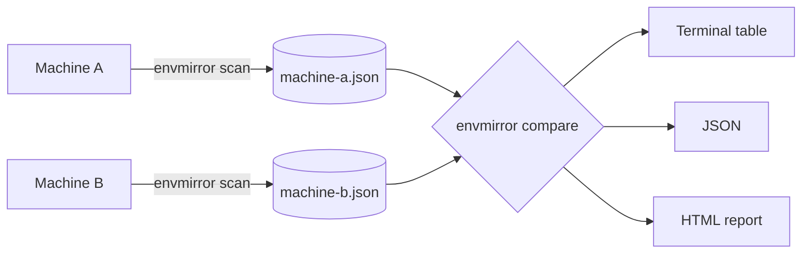
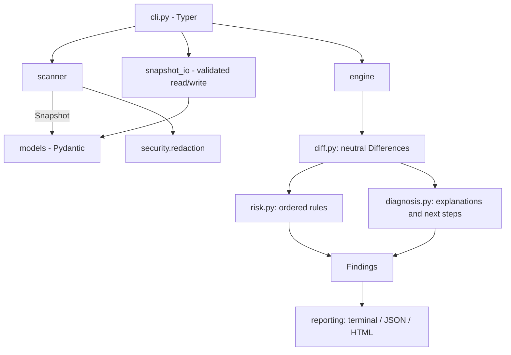

# EnvMirror

**Compare development environments. Find configuration drift.**

EnvMirror is a local-first command-line tool that records a *snapshot* of a development
machine (runtimes, tools, installed Python packages, a project's declared Node dependencies and
a few non-sensitive settings) and compares two snapshots to show where the machines differ.
No cloud service, no account, no API key, no telemetry, no network access.

> **Status: 0.1.0, not yet published to PyPI.** Install from source (see below).
> The first public CI run on Windows, Linux and macOS is still pending; see
> [Supported platforms](#12-supported-platforms) for what has and has not been verified.

## 1. Problem statement

"It works on my machine" usually means *something differs* between two machines: a runtime
major version, a missing tool, a different CPU architecture, a package that resolved to another
version, a package manager that installed differently. Finding that difference by hand means
running a dozen `--version` commands on two machines and comparing the output by eye.

EnvMirror automates the comparison. It reports **environmental drift**: facts about how two
environments differ. It does **not** prove that any particular difference *caused* a failure
(see [Drift versus causation](#drift-versus-causation)).

## 2. Features

- `scan` a machine into a versioned, deterministic JSON snapshot
- `compare` two snapshots with a rule-based risk rating for every difference
- Terminal output (Rich), machine-readable JSON, or a self-contained dark-theme HTML report
- Detects Python, Node.js, npm, Java, rustc, Git and Docker (each optional; missing ones never crash a scan)
- Reads installed Python distributions through `importlib.metadata`, never by parsing `pip list`
- Reads `package.json` and lockfile *presence* in the project directory; never runs npm, npx or scripts
- Secrets are redacted **before** they enter the snapshot; environment values are opt-in
- Strict snapshot validation, schema versioning and a migration hook
- Exit codes suitable for scripts and CI

## 3. Installation

Requires Python 3.11 or newer.

```bash
git clone https://github.com/OWNER/envmirror.git   # replace OWNER once published
cd envmirror
python -m venv .venv
# Linux/macOS: source .venv/bin/activate     Windows PowerShell: .venv\Scripts\Activate.ps1
pip install .
envmirror --version
```

For development: `pip install -e ".[dev]"`.

## 4. Quick start

```bash
# Machine A (the reference: where it works)
envmirror scan --output machine-a.json
# Machine B (where it fails)
envmirror scan --output machine-b.json

envmirror compare machine-a.json machine-b.json
envmirror compare machine-a.json machine-b.json --html report.html
```

Argument order matters: the **first** snapshot is the *baseline* (expected), the **second** is the
*target* under investigation. "Missing" means present in the baseline but absent in the target.

## 5. Command reference

| Command | Purpose |
| --- | --- |
| `envmirror scan` | Scan this machine. Prints a summary, or writes JSON with `--output FILE`. |
| `envmirror compare BASELINE TARGET` | Compare two snapshots. |
| `envmirror inspect SNAPSHOT` | Show a snapshot (`--format json` prints normalized JSON). |
| `envmirror validate SNAPSHOT` | Check that a file is a valid snapshot. |

Global options (before the command): `-q/--quiet`, `-v/--verbose`, `--version`.

`scan` options: `-o/--output FILE`, `-p/--project DIR` (default: current directory; reads only its
`package.json` and checks for lockfile names), `--no-project`, `-f/--format text|json`,
`--include-env-names` and `--env-value NAME` (both opt-in, see [Privacy](#11-privacy-and-security)).

`compare` options: `--html FILE`, `-f/--format text|json`, `--fail-on critical|high|medium|low|info|none` (default `high`).

| Exit code | Meaning |
| --- | --- |
| 0 | Success (for `compare`: no finding at or above `--fail-on`) |
| 1 | `compare` found differences at or above `--fail-on` |
| 2 | Command-line usage error (e.g. unknown option, nonexistent `--project`) |
| 3 | Snapshot missing, unreadable, malformed or invalid |
| 4 | Output file could not be written |

In `--format json` mode only the JSON document is written to stdout and no progress output is
produced. Progress and diagnostics always go to stderr.

## 6. Example workflow

The repository ships two **hand-written, illustrative** snapshots in [`examples/`](examples/)
(they were not scanned from real machines): a Linux x86-64 workstation and a Windows ARM64 laptop.

```bash
envmirror compare examples/machine-a.json examples/machine-b.json --html report.html
```



## 7. Example comparison output

Findings the engine produces for the example pair (22 in total: 6 high, 10 medium, 3 low, 3 info;
full data in [`examples/comparison.json`](examples/comparison.json)). The table below is a
simplified plain-text rendering of those findings; the real terminal output is a styled Rich
table and looks different.

```
SEVERITY  FIELD                                    BASELINE      TARGET
HIGH      system.architecture                      x86_64        arm64
HIGH      runtimes.node                            22.4.0        18.20.4
HIGH      runtimes.java                            21.0.3        -
HIGH      packages.python.pydantic                 2.8.2         1.10.17
HIGH      packages.node.dependencies.next          ^14.2.5       ^13.5.6
HIGH      packages.node.dependencies.zod           ^3.23.8       -
MEDIUM    runtimes.python                          3.12.3        3.11.9
MEDIUM    tools.docker                             26.1.4        -
MEDIUM    environment.values.NODE_ENV              development   production
...
INFO      system.platform                          Linux         Windows
```

Each finding also carries a stable id (`RM-ARCH:system.architecture`), a category, a
classification, an explanation and a suggested diagnostic step.

## 8. HTML report preview

[`examples/report.html`](examples/report.html) is the report generated from the example pair.
Open it in a browser. It is a single file with inline CSS, no JavaScript, no external requests, and
a restrictive `Content-Security-Policy`. Sections: overview, summary statistics, risk
distribution, system / runtime / dependency / tool / environment differences, detailed findings,
diagnostic recommendations and snapshot metadata. (No screenshot is included.)

## 9. How it works



The comparison engine is three small layers so each can be tested alone:
`diff.py` states *what differs* without opinion, `risk.py` applies an ordered, declarative rule
table (first match wins; each rule has an id and a plain-language reason), and `diagnosis.py`
writes cautious explanations and next steps.

### Drift versus causation

EnvMirror detects that two environments **differ**. It cannot tell you **why** a program failed.

- A reported difference may be irrelevant to your failure.
- The real cause may be something EnvMirror does not record (code, data, network, permissions,
  hardware, services, files outside the scanned scope).
- Severities are heuristics about *compatibility risk* ("major runtime versions often change
  behavior"), not evidence of causality. Classifications are `confirmed_difference` (something
  exists on only one side), `potential_compatibility_risk` and `informational`.
- Identical snapshots do not prove identical behavior.

Treat the report as a ranked list of leads to investigate.

## 10. Snapshot schema

Full field reference and evolution policy: [`docs/snapshot-schema.md`](docs/snapshot-schema.md).
Abbreviated example:

```json
{
  "schema_version": "1.0",
  "envmirror_version": "0.1.0",
  "created_at": "2026-11-04T09:15:00Z",
  "system": { "platform": "Linux", "architecture": "x86_64", "os_release": "6.8.0-45-generic" },
  "runtimes": { "node": { "status": "found", "version": "22.4.0" } },
  "tools": { "docker": { "status": "not_found" } },
  "packages": { "python": { "requests": "2.32.3" }, "node": { "dependencies": { "react": "^18.3.1" } } },
  "environment": { "values": { "LANG": "en_US.UTF-8" }, "present": ["VIRTUAL_ENV"] },
  "metadata": { "scanner_version": "0.1.0", "project_scanned": true, "scan_warnings": [] }
}
```

Serialization is deterministic (sorted keys, UTF-8, 2-space indent, trailing newline).
Snapshots are portable between operating systems; architecture names are normalized
(`AMD64` becomes `x86_64`, `aarch64` becomes `arm64`).

## 11. Privacy and security

**What a default scan records:** OS name/release/version, normalized architecture, CPU count,
Python implementation, runtime and tool versions, installed Python distribution names and versions,
`package.json` dependency specs / engines / `packageManager` / lockfile file names (if a project is
scanned), values of a short allow-list of non-path variables (`LANG`, `LC_ALL`, `TZ`, `NODE_ENV`,
`CI`, `PYTHONUTF8`, `PYTHONIOENCODING`), and the *presence* (not value) of variables such as
`VIRTUAL_ENV`, `PYTHONPATH`, `JAVA_HOME` and proxy settings.

**What it does not record:** hostnames, usernames, home-directory paths, the Python executable
path, environment variable values outside the allow-list, file contents other than
`package.json`, or anything from other directories.

**Opt-in extras (with privacy warnings in `--help`):** `--include-env-names` records the *names*
of all variables; `--env-value NAME` records one named value. Variables with secret-looking names
are always stored as `[REDACTED]`, and values are passed through token/credential pattern
redaction. Review any snapshot before sharing it.

**Safeguards:** redaction happens before serialization; subprocesses never use a shell, have a
timeout and bounded output, and run only fixed `--version` style probes; snapshot files are never
executed or used to choose commands; no network access anywhere; snapshot input is size-limited,
duplicate-key-checked and validated (control characters are rejected); HTML is generated with
autoescaping and a restrictive CSP; terminal output treats snapshot data as plain text.

**Honest limits:** redaction is heuristic (name and pattern based) and cannot guarantee that no
sensitive string survives, particularly with `--env-value`. The tests cover these protections but
are not a security audit. Report vulnerabilities as described in [SECURITY.md](SECURITY.md).

## 12. Supported platforms

Designed for Linux, macOS and Windows with Python 3.11-3.13; the CI workflow
([`.github/workflows/ci.yml`](.github/workflows/ci.yml)) targets that matrix. See the project's
delivery notes for what was actually executed so far; the workflow itself has not yet run on GitHub.

## 13. Limitations

- Only the Python environment that runs EnvMirror is inspected (its packages and its version
  stand for the `python` runtime). Run it inside the virtual environment you want to compare.
- Node data comes from `package.json` only: declared ranges, not installed or locked versions.
  Lockfile contents are not read.
- Python snapshots do not record which packages a project *requires*, so a missing Python package is
  rated MEDIUM, not HIGH.
- Detection runs `<tool> --version`-style commands found on `PATH`; unusual builds or wrappers may
  produce unrecognized output (recorded as `error`, not guessed).
- Docker is only detected, not inspected; container contents are out of scope.
- Versions are compared numerically (major.minor.patch). Pre-release ordering and complex npm
  ranges are not interpreted.
- Not covered: system libraries, compilers, shell configuration, services, file contents, hardware.

## 14. Roadmap

Ideas, not promises: Python requirements/lockfile awareness, reading installed Node versions from
lockfiles, more runtimes (Go, .NET, Ruby), snapshot signing, configurable rule sets, SARIF output.

## 15. Contributing

See [CONTRIBUTING.md](CONTRIBUTING.md). Quick check before a pull request:

```bash
pip install -e ".[dev]"
ruff check . && mypy && pytest
```

## 16. License

MIT. See [LICENSE](LICENSE).
